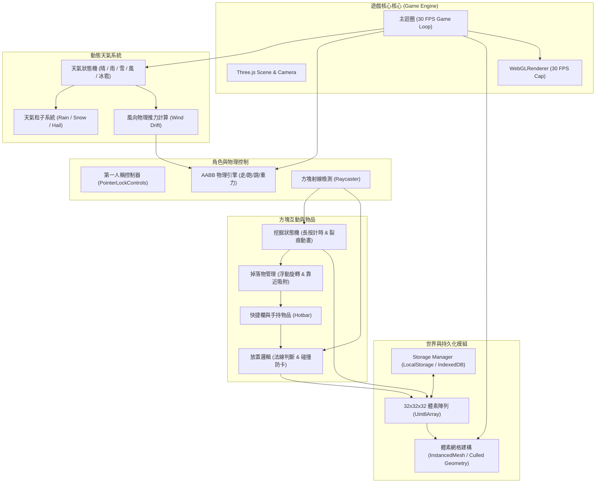

# 專案設計簡報 (Project Brief) - 類似 Minecraft 體素世界程式

> **專案名稱**：Mini Voxel World (輕量級體素世界)  
> **專案狀態**：架構設計完成 / 待開發  
> **最後更新**：2026-10-22  
> **核心技術棧**：Three.js (WebGL), HTML5 / JavaScript (Vanilla / Modern ES Module)  

---

## 1. 專案概述 (Project Overview)

本專案旨在打造一個網頁版、微型且沉浸感十足的 **類似 Minecraft 單人體素沙盒世界**。遊戲採用復古 16×16 像素風格，在緊湊的 $32 \times 32 \times 32$ 空間內，重現經典的體素採掘與自由建造體驗，並結合具備物理交互的動態天氣系統（如強風偏移走位、冰雹受傷等）。

### 核心定位
- **極致輕量**：單人離線遊玩、免複雜安裝、免伺服器。
- **經典回歸**：專注於探索、採礦、建造與生存微挑戰（無怪物、無複雜合成）。
- **沉浸動態**：天氣不再只是視覺背景，而是直接影響玩家操作（風阻偏轉）與生存機制（冰雹砸傷）。

---

## 2. 功能範疇與規格對照 (Scope & Requirements)

### ✅ 要實作的功能 (In-Scope)

1. **玩家移動與控制器 (Player Movement & Controller)**：
   - **控制方向鍵 (Directional Movement)**：
     - **前**：`W`
     - **後**：`S`
     - **左**：`A`
     - **右**：`D`
   - **走路 (Walk)**：標準四向平移，視角採用滑鼠鎖定（Pointer Lock API）。
   - **跑步 (Sprint)**：雙擊前進鍵 (`W`) 或按住 `Shift` 鍵進入奔跑狀態，移動速度提升。
   - **跳躍 (Jump)**：空白鍵 (`Space`) 觸發跳躍，包含重力加速度與觸地判斷。
   - **趴下與爬行 (Prone / Crawl)**：按下 `L` 鍵往下趴著（視角與碰撞體積降低），趴著時依然可利用方向鍵（前 W、後 S、左 A、右 D）移動（匍匐前進）。
   - **物理碰撞與剛體**：AABB（軸對齊邊界盒）與體素網格的精確碰撞判定，防止穿牆、穿地或浮空。

2. **方塊互動與建造系統 (Block Interactions & Building)**：
   - **挖方塊 (Mining / Digging)**：
     - 滑鼠左鍵持續點擊目標方塊進行破壞。
     - 顯示段階式 **16×16 破壞裂痕貼圖**（Cracking animation 0~9 階段）。
   - **掉落物與拾取 (Item Drop & Pickup)**：
     - 方塊挖掘完畢後，在原處生成旋轉、浮動的縮小版掉落物（Drop Entity）。
     - 玩家靠近至一定半徑（如 1.5 格內）時自動吸附並撿起，存入物品快捷欄（Hotbar）。
   - **放回去 (Block Placement)**：
     - 滑鼠右鍵點擊相鄰方塊表面法線（Normal）方向放置目前手持方塊。
     - 具備防重疊判定（若玩家身體正處於該格位置則禁止放置，避免卡點）。
   - **建造持久化 (World Persistence)**：
     - 所有挖掘、放置的方塊變更均即時儲存於本機儲存空間（`LocalStorage` 或 `IndexedDB`）。
     - 重新整理網頁或再次進入時，完整還原玩家所建造的世界。

3. **動態天氣與物理影響系統 (Dynamic Weather System)**：
   - **下雪 (Snow)**：
     - 柔和的白色雪花粒子緩慢飄落。
     - 環境光線微調，營造寒冷氛圍。
   - **下雨 (Rain)**：
     - 垂直高速的雨滴粒子系統，天空變暗。
   - **颳風 (Wind / Gale)**：
     - 生成水平流動的風力粒子與空氣流動視覺。
     - **物理影響**：全域風力向量 $\vec{F}_{\text{wind}}$，使玩家走路/跑步時的方向**強制產生偏向與位移漂移**。
   - **冰雹 (Hail)**：
     - 快速且密集下墜的小冰塊粒子效果，營造惡劣天候氛圍。

4. **介面與狀態 (UI & Status)**：
   - **十字準星 (Crosshair)**：畫面中心點鎖定方塊。
   - **物品快捷列 (Hotbar)**：顯示當前手持方塊種類、堆疊數量與 16×16 圖示。
   - **天氣與風向指示器**：顯示當前天氣狀態與風向羅盤/風向箭頭。

---

### ❌ 明確不做的事項 (Out-of-Scope)

- ❌ **多人連線 (Multiplayer / Networking)**：不支援 WebSocket、WebRTC 或多人房室，純單機本機運作。
- ❌ **打怪與敵對生物 (Combat & Mobs)**：無殭屍、骷髏、苦力怕等敵對或被動 NPC 生物生成。
- ❌ **合成系統 (Crafting System)**：無工作台（Crafting Table）、熔爐或配方合成介面。挖掘取得的方塊可直接放置使用。

---

## 3. 系統限制與技術規格 (Constraints & Technical Specifications)

| 項目 | 規格標準 | 實作策略 / 備註 |
| :--- | :--- | :--- |
| **渲染引擎** | **Three.js** (WebGL) | 使用現代 Three.js (r128+) 與標準透視相機 (`PerspectiveCamera`) |
| **目標幀率** | **30 FPS** | 透過 `requestAnimationFrame` 配合時間步長限制器（Delta Time Cap）固定於 30 FPS 刷新，節省運算資源 |
| **世界規模** | **$32 \times 32 \times 32$ 格** | 總體素上限為 32,768 格。空間邊界設有限制，適合單一 Chunk / 空島架構 |
| **材質解析度** | **16×16 像素** | 紋理過濾設定為 `THREE.NearestFilter`，確保像素紋理邊緣銳利不模糊 |
| **貼圖資源來源** | **`sky-island-assets.zip`** | 包含： 1. 方塊表面紋理 (Grass, Dirt, Stone, Wood, Leaves 等) 2. 快捷欄方塊圖示 (Icons) 3. 挖掘破壞裂痕紋理 (Mining Cracks 0~9) |
| **資料儲存機制** | **Web LocalStorage / IndexedDB** | 儲存 $32 \times 32 \times 32$ 陣列的修改差分（Delta）或壓縮二進位資料 (`Uint8Array`) |

---

## 4. 系統架構設計 (System Architecture)

---

## 5. 細部機制實作規劃 (Detailed Mechanics)

### 5.1 體素渲染優化 (32×32×32)
- **記憶體結構**：以長度 $32 \times 32 \times 32 = 32,768$ 的 `Uint8Array` 儲存方塊 ID（`0` 代表空氣）。
- **面剔除渲染 (Culled Faces)**：只為緊鄰空氣或透明方塊的外露面建立頂點，不渲染內部不可見面；或使用 `THREE.InstancedMesh` 進行方塊批次渲染，確保在 30 FPS 下穩定運作。

### 5.2 挖掘與裂痕動畫 (Mining & Cracks)
- 玩家長按滑鼠左鍵瞄準方塊時：
  1. 啟動計時器，依據方塊硬度每達特定比例切換對應的 16×16 裂痕材質（共 10 階：0 至 9）。
  2. 裂痕以覆蓋層（Overlay Mesh / Decal）貼附於目標方塊表面。
  3. 若滑鼠鬆開或視角移開，重置挖掘進度。
  4. 破壞完成時：該格資料改為 0，更新網格，並在中心生成掉落物實體。

### 5.3 天氣與環境影響機制 (Weather & Physics)
- **天氣輪替狀態機**：
  - 每隔固定時間（例如 60~120 秒）隨機切換：`Clear`（晴）、`Rain`（雨）、`Snow`（雪）、`Windy`（風）、`Hail`（冰雹）。
- **風力偏移 (Wind Drift)**：
  - 當前天氣為 `Windy` 時，生成一個二維風向向量（如 $\vec{W} = (w_x, w_z)$）。
  - 在角色每幀更新位置時：$\vec{V}_{\text{final}} = \vec{V}_{\text{input}} + \vec{W} \times \Delta t$。
  - 玩家走路時會感受到明顯側推力，需要逆風調整移動視角。
- **冰雹環境效果 (Hail Particles)**：
  - 當前天氣為 `Hail` 時，生成密集快速墜落的小冰塊粒子，營造劇烈天氣氛圍。

---

## 6. 使用者操作與鍵位對應 (Keybindings)

| 動作 / 功能 | 操作按鍵 | 備註 |
| :--- | :--- | :--- |
| **視角轉動** | 滑鼠移動 | 點擊畫面啟用 Pointer Lock 鎖定游標 |
| **向前移動 (前)** | `W` | 向前走動（雙擊或按 Shift 奔跑） |
| **向後移動 (後)** | `S` | 向後退走動 |
| **向左移動 (左)** | `A` | 向左橫移走動 |
| **向右移動 (右)** | `D` | 向右橫移走動 |
| **跑步 (Sprint)** | 按住 `Left Shift` + `W` | 移動速度增加 50% |
| **跳躍 (Jump)** | `Space` (空白鍵) | 僅在觸地時可跳起 |
| **趴下 (Prone)** | `L` 鍵 | 視角高度降低，可趴著走動 |
| **挖掘方塊** | 滑鼠左鍵 (長按) | 顯示 16×16 裂痕貼圖，挖掘進度滿後破壞 |
| **放置方塊** | 滑鼠右鍵 | 放置快捷欄當前選中的方塊 |
| **切換手持方塊** | 數字鍵 `1` ~ `9` 或滑鼠滾輪 | 於快捷列中循環選擇方塊 |
| **暫停 / 釋放游標** | `ESC` | 釋放滑鼠控制並開啟選單 |

---

## 7. 時程規劃與里程碑 (Timeline & Milestones)

| 階段 | 階段名稱 | 核心交付內容 |
| :--- | :--- | :--- |
| **Phase 1** | **基礎設施與渲染管線** | 建立 Three.js 場景、鎖定 30 FPS 循環、載入 `sky-island-assets.zip` 貼圖、生成 $32 \times 32 \times 32$ 初始地形 |
| **Phase 2** | **物理與第一人稱控制器** | 第一人稱視角 (Pointer Lock)、走/跑/跳控制、AABB 方塊碰撞系統 |
| **Phase 3** | **方塊互動與存檔** | 挖掘 (16×16 裂痕動畫)、掉落物生成與拾取、放方塊、`LocalStorage/IndexedDB` 持久化儲存 |
| **Phase 4** | **動態天氣與環境物理** | 雨/雪/冰雹粒子效果、強風位移偏向向量 |
| **Phase 5** | **UI 整合與整體優化** | 快捷欄、十字準星、天氣狀態 HUD、效能優化與邊界防護 |
