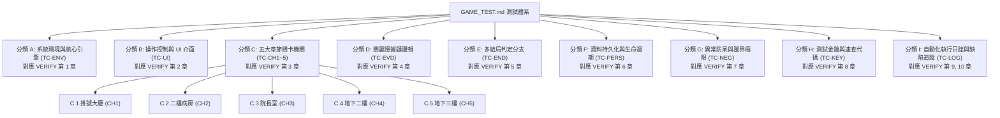

# 密室逃脫遊戲測試規格與執行手冊 (GAME_TEST.md)

<div align="center">

# 《回生病院 · 第044號病患》
### 臺灣懸疑密室逃脫 · 遊戲測試分類規格表與品管手冊

[](https://huisheng-case044-oct29.dingyuegpt.chatgpt.site)
[-brightgreen?style=for-the-badge&logo=checkmarx)](https://huisheng-case044-oct29.dingyuegpt.chatgpt.site)
[](https://huisheng-case044-oct29.dingyuegpt.chatgpt.site)
[](https://huisheng-case044-oct29.dingyuegpt.chatgpt.site)

</div>

---

> [!IMPORTANT]
> **專案名稱**：《回生病院 · 第044號病患》（HUI-SHENG · CASE 044）  
> **線上體驗網址**：[https://huisheng-case044-oct29.dingyuegpt.chatgpt.site](https://huisheng-case044-oct29.dingyuegpt.chatgpt.site)  
> **關聯驗證矩陣**：完整規範請對照 [GAME_VERIFY.md](file:///Users/a123/design2/GAME_VERIFY.md)  
> **本手冊定位**：測試執行與品管規格手冊，依據 9 大核心分類建立標準測試用例與編輯架構，供品管人員檢驗與後續自訂擴充。

---

## 測試分類架構導覽圖 (Taxonomy Overview)



---

## 測試分類與 GAME_VERIFY.md 對照索引 (Classification Mapping)

| 分類代號 | 測試分類名稱 | 核心測試目標 | 對應 VERIFY.md 章節 | 用例編號範圍 | 預設狀態 |
| :---: | :--- | :--- | :--- | :---: | :---: |
| **分類 A** | **系統環境與核心引擎** | WebGL 渲染管線、音效引擎、規則庫、視角模組加載 | [第 1 章 測試環境與系統規範](file:///Users/a123/design2/GAME_VERIFY.md#1-測試環境與系統規範-test-environment) | TC-ENV-01 ~ 04 | ✅ 通過 |
| **分類 B** | **操作控制與 UI 介面** | 3D 第一人稱控制、PointerLock、觸控、亮度、音量、暫停 | [第 2 章 操作控制與介面系統驗證](file:///Users/a123/design2/GAME_VERIFY.md#2-操作控制與介面系統驗證-controls--ui-verification) | TC-UI-01 ~ 07 | ✅ 通過 |
| **分類 C** | **五大章節關卡機關** | CH1 大廳 $\rightarrow$ CH5 B3 各區 30 個調查點與主線解謎 | [第 3 章 五大章節關卡驗證矩陣](file:///Users/a123/design2/GAME_VERIFY.md#3-五大章節關卡驗證矩陣-chapter-matrix) | TC-CH1 ~ CH5 | ✅ 通過 |
| **分類 D** | **關鍵證據鏈邏輯** | E01～E05 之 5 條關鍵證據鏈成立邏輯與條件 | [第 4 章 五大證據鏈解鎖校驗](file:///Users/a123/design2/GAME_VERIFY.md#4-五大證據鏈解鎖校驗-evidence-chains-e01e05) | TC-EVD-01 ~ 05 | ✅ 通過 |
| **分類 E** | **多結局判定分支** | 隱藏結局、普通結局、真結局判定條件與封存報告 | [第 5 章 三大結局分支判定矩陣](file:///Users/a123/design2/GAME_VERIFY.md#5-三大結局分支判定矩陣-endings-matrix) | TC-END-01 ~ 05 | ✅ 通過 |
| **分類 F** | **資料持久化與生命週期** | LocalStorage 存檔欄位、F5 刷新復原、JSON 匯出、重新開始 | [第 6 章 資料持久化與報告匯出測試](file:///Users/a123/design2/GAME_VERIFY.md#6-資料持久化與報告匯出測試-persistence--export) | TC-PERS-01 ~ 03 | ✅ 通過 |
| **分類 G** | **異常防呆與邊界極限** | 跨章跳關防護、空輸入攔截、超載跳脫、貨梯獨立供電 | [第 7 章 防呆機制與邊界異常測試](file:///Users/a123/design2/GAME_VERIFY.md#7-防呆機制與邊界異常測試-negative--edge-cases) | TC-NEG-01 ~ 08 | ✅ 通過 |
| **分類 H** | **測試金鑰與速查代碼** | 密碼、日期、方位、負載、特徵勾選快速驗證值 | [第 8 章 通關謎底與通訊代碼速查表](file:///Users/a123/design2/GAME_VERIFY.md#8-通關謎底與通訊代碼速查表-cheat-sheet--answer-key) | TC-KEY-01 ~ 10 | ✅ 基準值就緒 |
| **分類 I** | **自動化執行與缺陷追蹤** | 52 項 CDP 自動化執行日誌、環境除錯紀錄、品管審查簽核 | [第 9, 10 章 執行紀錄與 Git Commit](file:///Users/a123/design2/GAME_VERIFY.md#9-端對端自動化測試成果紀錄-automated-test-execution-log) | TC-LOG-01 ~ 02 | ✅ 審查合格 |

---

## 分類 A：系統環境與核心引擎測試 (TC-ENV)
> **對應來源**：[GAME_VERIFY.md 第 1 章 測試環境與系統規範](file:///Users/a123/design2/GAME_VERIFY.md#1-測試環境與系統規範-test-environment)  
> **分類說明**：檢驗遊戲於現代瀏覽器中之底層技術堆疊、資源加載穩定性與全域核心模組狀態。

| 用例編號 | 測試項目名稱 | 前置條件 / 觸發點 | 測試操作步驟 | 預期判定結果 | 邊界與異常判定 | 程式碼 / Flag 依據 | 狀態 | 編輯備註 |
| :---: | :--- | :--- | :--- | :--- | :--- | :--- | :---: | :--- |
| **TC-ENV-01** | 網頁基本載入 | 網路連線正常 | 發起 GET 請求並解析 HTML DOM | 標題包含 `回生病院 · 第044號病患`，HTTP 200 | 首頁載入時間 $\le 2.5\text{s}$，無阻塞 | `document.title` | ✅ PASS | 【可編輯自訂載入秒數門檻】 |
| **TC-ENV-02** | 音效引擎模組 | 網頁完成加載 | 檢查全域物件 `window.HorrorAudio` | 模組掛載成功，具備 `start`, `cue`, `volume` | 瀏覽器 Autoplay 策略下不引發未捕獲錯誤 | `typeof HorrorAudio !== 'undefined'` | ✅ PASS | 【可編輯音訊支援清單】 |
| **TC-ENV-03** | 3D第一人稱模組 | 網頁完成加載 | 檢查全域物件 `window.Explore` | 模組掛載成功，提供相機、走廊幾何與視角事件 | 支援 WebGL context 正常初始化 | `typeof Explore !== 'undefined'` | ✅ PASS | 【可編輯相機視野 FOV 範圍】 |
| **TC-ENV-04** | 遊戲規則核心庫 | 網頁完成加載 | 檢查全域物件 `window.Engine` | 核心庫包含 `evidence`, `ending`, `report` 函式 | 無全域變數污染或未定義方法呼叫 | `typeof Engine !== 'undefined'` | ✅ PASS | 【可編輯核心引擎依賴清單】 |

> 📝 **分類 A 細節編輯預留區**：
> ```markdown
> <!-- 請在此處補充分類 A 的自訂環境測試需求（如：多種 GPU 渲染管線測試、各作業系統測試條件） -->
> ```

---

## 分類 B：操作控制與 UI 介面系統測試 (TC-UI)
> **對應來源**：[GAME_VERIFY.md 第 2 章 操作控制與介面系統驗證](file:///Users/a123/design2/GAME_VERIFY.md#2-操作控制與介面系統驗證-controls--ui-verification)  
> **分類說明**：驗證玩家於 3D 空間中之控制手感、相機俯仰角防護、選單 HUD 渲染及行動裝置相容性。

| 用例編號 | 測試項目名稱 | 前置條件 / 觸發點 | 測試操作步驟 | 預期判定結果 | 邊界與異常判定 | 程式碼 / Flag 依據 | 狀態 | 編輯備註 |
| :---: | :--- | :--- | :--- | :--- | :--- | :--- | :---: | :--- |
| **TC-UI-01** | 首頁 Landing 渲染 | 開啟網站首頁 | 查詢節點 `.landing` 與主按鈕 | 正確呈現醫院背景、標題與「拆開祖母的遺物」按鈕 | 按鈕可點擊且具備 hover 反饋 | `document.querySelector('.landing')` | ✅ PASS | 【可編輯首頁字串檢核】 |
| **TC-UI-02** | 序章對話框觸發 | 點擊遺物按鈕 | 執行 `action('prologue')` | 彈出 `#dialog`，呈現父親遺物與舊公文背景導言 | 點擊遮罩外不應意外閃退視窗 | `#dialog.showModal()` | ✅ PASS | 【可編輯導言文本校對】 |
| **TC-UI-03** | 操作指引視窗 | 點擊操作說明 | 執行 `action('help')` | 彈出操作指引彈窗，詳細說明 WASD, E, F, J 用途 | 支援點擊「我知道了」平滑關閉 | `helpDialog.open` | ✅ PASS | 【可編輯按鍵對照說明】 |
| **TC-UI-04** | 正式開始狀態切換 | 序章點擊進入 | 執行 `action('start')` | `state.started: true`，首頁隱藏，切換為 3D 畫布 | 避免重複觸發 start 造成重複迴圈 | `state.started === true` | ✅ PASS | 【可編輯進場過場動畫】 |
| **TC-UI-05** | 3D Canvas 管線 | 遊戲正式開始 | 檢查 DOM 節點 `#world` | Three.js WebGLRenderer 成功綁定 Canvas | 視窗縮放 (Resize) 時相機寬高比自動更新 | `#world > canvas` | ✅ PASS | 【可編輯畫質與抗鋸齒設定】 |
| **TC-UI-06** | 畫面與音量偏好 | 暫停選單中調整 | 變更亮度滑桿與音量控制 | 數值即時生效並精準存入 `localStorage` | 亮度限制在 0.8～1.9 區間防過曝 | `huisheng-preferences` | ✅ PASS | 【可編輯預設亮度值】 |
| **TC-UI-07** | 調查筆記視窗 (J) | 探索中按 `J` | 觸發 `action('notes')` | 彈出調查筆記，同步顯示已解鎖證據鏈與文件卡片 | 未取得證據呈現鎖定灰階樣式 | `f.notesOpened` | ✅ PASS | 【可編輯筆記分頁排版】 |

> 📝 **分類 B 細節編輯預留區**：
> ```markdown
> <!-- 請在此處補充分類 B 的自訂控制細節（如：手把支援測試、滑鼠靈敏度曲線調整、無障礙導航測試） -->
> ```

---

## 分類 C：五大章節關卡機關測試 (TC-CH1 ~ TC-CH5)
> **對應來源**：[GAME_VERIFY.md 第 3 章 五大章節關卡驗證矩陣](file:///Users/a123/design2/GAME_VERIFY.md#3-五大章節關卡驗證矩陣-chapter-matrix)  
> **分類說明**：完整覆蓋 30 個場景物件調查、機關密碼驗證、道具取得與章節推進流程。

### C.1 Chapter 01 掛號大廳（Lobby, 23:55）
> **主線目標**：比對處置日期，解開電腦檔案，開啟二樓安全鐵門。

| 用例編號 | 測試項目名稱 | 前置條件 / 觸發點 | 測試操作步驟與輸入 | 預期判定結果 | 邊界與異常防呆 | 程式碼 / Flag | 狀態 | 編輯備註 |
| :---: | :--- | :--- | :--- | :--- | :--- | :--- | :---: | :--- |
| **TC-CH1-01** | 調查沿革公告 | 進入大廳 | 調查物件 `history` | 閱讀開院歷史（民國76年），標記 `f.history` | 重複點擊不拋出例外 | `flags.history` | ✅ PASS | 【可編輯公告文本】 |
| **TC-CH1-02** | 放大死亡登記章 | 調查死亡登記簿 | 點擊「放大登記章」按鈕 | 標記 `f.stamp`，發現「九十一年式印章」矛盾 | 未放大前不給予 flag | `flags.stamp` | ✅ PASS | 【可編輯矛盾提示】 |
| **TC-CH1-03** | 藥局雙簽章檢驗 | 調查藥局領藥處 | 點擊「檢查雙簽章」 | 標記 `f.sign`，確認 8/19 仍有處置記錄 | 無雙簽不成立 E01 | `flags.sign` | ✅ PASS | 【可編輯簽章日期】 |
| **TC-CH1-04** | 收據翻面搜抽屜 | 調查收費處收據 | 收據翻到背面並搜尋抽屜 | 標記 `f.back`，隨身背包新增 `薄金屬尺` | 背包陣列去重保護 | `flags.back`, `inv:薄金屬尺` | ✅ PASS | 【可編輯背包上限】 |
| **TC-CH1-05** | 電腦年份錯誤引導 | 調查掛號處電腦 | 輸入 `1990`（啟用年份） | 彈出 Toast 提示「這是住院大樓啟用年份」 | 不扣減嘗試次數 | Toast 回饋 | ✅ PASS | 【可編輯引導文案】 |
| **TC-CH1-06** | 電腦正確登入 | 調查掛號處電腦 | 輸入正確年份 `1987` | 登入成功，標記 `f.login`，開放日期查詢 | 登入後密碼框鎖定 | `flags.login` | ✅ PASS | 【可編輯登入密碼】 |
| **TC-CH1-07** | 處置日期查詢 | 電腦登入完成 | 輸入日期代碼 `0819` | 標記 `f.archive`，畫面揭示二樓授權碼 `2074` | 輸入錯誤提示查無記錄 | `flags.archive` | ✅ PASS | 【可編輯檔案代碼】 |
| **TC-CH1-08** | 鐵門錯誤防呆 | 調查安全鐵門 | 輸入錯誤授權碼 `0000` | 彈出 Toast 提示「授權碼不符」，門禁不開啟 | 門禁保持關閉鎖定 | Toast: 授權碼不符 | ✅ PASS | 【可編輯防呆延遲】 |
| **TC-CH1-09** | 開啟鐵門進入二樓 | 取得授權碼 | 輸入授權碼 `2074` | 播放開門音效，房間切換為二樓 (`room: 1`) | 成功推進至 Chapter 02 | `state.room = 1` | ✅ PASS | 【可編輯切換動畫】 |

---

### C.2 Chapter 02 二樓病房（2F Wards, 00:18）
> **主線目標**：比對隱藏床位，撬開逃生圖，解開 205 踢腳板暗門進入 207 病房。

| 用例編號 | 測試項目名稱 | 前置條件 / 觸發點 | 測試操作步驟與輸入 | 預期判定結果 | 邊界與異常防呆 | 程式碼 / Flag | 狀態 | 編輯備註 |
| :---: | :--- | :--- | :--- | :--- | :--- | :--- | :---: | :--- |
| **TC-CH2-01** | 計算短少床位 | 調查護理站床位表 | 輸入短少床數 `4` | 標記 `f.bedcount`（總數 28 - 公開 24 = 4） | 輸入非 4 提示比對平面圖 | `flags.bedcount` | ✅ PASS | 【可編輯床位差額】 |
| **TC-CH2-02** | 金屬尺撬圖疊合 | 調查逃生路線圖 | 使用 `薄金屬尺` 撬框並疊合 | 標記 `f.pried` 與 `f.overlay`，發現隱藏暗間 | 缺少金屬尺提示需回大廳尋找 | `flags.pried`, `flags.overlay` | ✅ PASS | 【可編輯道具關聯】 |
| **TC-CH2-03** | 事件磁帶順序排列 | 調查護理站錄音機 | 依事件順序輸入代碼 `ADBC` | 標記 `f.tapes`，第二軌提示房號 207 ＋ 床數 4 | 順序錯誤提示事件中斷 | `flags.tapes` | ✅ PASS | 【可編輯磁帶內容】 |
| **TC-CH2-04** | 拆卸踢腳板露出面板 | 調查 205 房外牆面 | 拾取起子並拆卸踢腳板螺絲 | 獲得 `螺絲起子`，標記 `f.panel` 露出暗門密碼鍵盤 | 未拿起子無法拆卸面板 | `flags.panel`, `inv:螺絲起子` | ✅ PASS | 【可編輯工具名稱】 |
| **TC-CH2-05** | 輸入暗門密碼 | 205 踢腳板面板露開 | 輸入密碼 `2074`（房號207+床數4） | 標記 `f.hidden`，207 特殊病房暗門順利開啟 | 密碼錯誤提示門禁錯誤 | `flags.hidden` | ✅ PASS | 【可編輯暗門代碼】 |
| **TC-CH2-06** | 調查 207 病房文件 | 暗門已開啟 | 調查 `hidden`，點擊收取四床文件 | 標記 `f.bedsRead`，收集完成 | 暗門未開前點擊阻擋調查 | `flags.bedsRead` | ✅ PASS | 【可編輯四床個案】 |
| **TC-CH2-07** | 前往院長室轉場 | 二樓調查完成 | 點擊導覽列「前往下一區域 →」 | 成功進入 Chapter 03，房間切換 `room: 2` | 暗門未開點擊跳出提示阻擋 | `state.room = 2` | ✅ PASS | 【可編輯轉場提示】 |

---

### C.3 Chapter 03 院長室（Director's Office, 00:51）
> **主線目標**：破解五行方位祭壇，開啟保險櫃黑帳，翻開藍圖夾層取得地下鑰匙。

| 用例編號 | 測試項目名稱 | 前置條件 / 觸發點 | 測試操作步驟與輸入 | 預期判定結果 | 邊界與異常防呆 | 程式碼 / Flag | 狀態 | 編輯備註 |
| :---: | :--- | :--- | :--- | :--- | :--- | :--- | :---: | :--- |
| **TC-CH3-01** | 閱讀日記與民俗書 | 進入院長室 | 調查 `diary` 與 `elements` | 標記 `f.diary`、`f.elements`，掌握五行方位 | - | `flags.diary`, `flags.elements` | ✅ PASS | 【可編輯院長心聲】 |
| **TC-CH3-02** | 五行方位祭壇解謎 | 調查五行祭壇 | 依方位放入木牌：東木、南火、中土、西金、北水 (`3,2,1,4,0`) | 抽屜解鎖，標記 `f.altar`，取得 `祭壇鑰匙` | 選錯方位提示卡榫未鬆動 | `flags.altar`, `inv:祭壇鑰匙` | ✅ PASS | 【可編輯五行順序】 |
| **TC-CH3-03** | 保險櫃黑帳開啟 | 取得祭壇鑰匙 | 調查 `safe` 使用祭壇鑰匙開啟 | 標記 `f.ledger`，讀取黑帳與器官交易代號 | 缺少鑰匙提示無法開啟 | `flags.ledger` | ✅ PASS | 【可編輯黑帳代號】 |
| **TC-CH3-04** | 留聲機歷史錄音 | 調查留聲機 | 調查 `record` | 播放院長對兒子承佑執念語音逐字稿 | - | 音訊與文字對齊 | ✅ PASS | 【可編輯錄音逐字】 |
| **TC-CH3-05** | 藍圖夾層獲取鑰匙 | 調查建築藍圖 | 調查 `blueprint` 翻開夾層前往 B1 | 標記 `f.b1`，獲得 `B1鑰匙` 與 `配電盤鑰匙` | 未翻夾層無法獲得配電鑰匙 | `flags.b1`, `inv:配電盤鑰匙` | ✅ PASS | 【可編輯道具名稱】 |
| **TC-CH3-06** | 前往地下二樓轉場 | 取得 B1 鑰匙 | 點擊「前往下一區域 →」 | 成功進入 Chapter 04，房間切換 `room: 3` | 缺少 B1鑰匙阻擋通行 | `state.room = 3` | ✅ PASS | 【可編輯門禁提示】 |

---

### C.4 Chapter 04 地下二樓（B2 Underground, 01:25）
> **主線目標**：切換供電迴路（負載 $\le 7\text{A}$），校正監控時間線，解讀手術紀錄，獨立供電搭乘貨梯。

| 用例編號 | 測試項目名稱 | 前置條件 / 觸發點 | 測試操作步驟與輸入 | 預期判定結果 | 邊界與異常防呆 | 程式碼 / Flag | 狀態 | 編輯備註 |
| :---: | :--- | :--- | :--- | :--- | :--- | :--- | :---: | :--- |
| **TC-CH4-01** | 配電盤超載跳脫 | 調查配電盤 | 同時勾選 A+B+C (負載 $4+3+2=9 > 7$) | 提示超載跳脫，全線斷電，標記 `tripped: true` | 超載時強制斷電 | `state.tripped === true` | ✅ PASS | 【可編輯負載限額】 |
| **TC-CH4-02** | 斷路器手動復歸 | 斷路器處於跳脫 | 點擊「復歸斷路器」按鈕 | 跳脫解除 `tripped: false`，總負載歸零 | 未復歸前任何迴路均無效 | `state.tripped === false` | ✅ PASS | 【可編輯復歸延遲】 |
| **TC-CH4-03** | 迴路 B+C 供電 | 斷路器正常 | 勾選 B（負載3）與 C（負載2） | 總負載 $5 \le 7$，套用供電 `power: ['B','C']` | - | `state.power` | ✅ PASS | 【可編輯各迴路A數】 |
| **TC-CH4-04** | 病理室器官代號 | B 迴路已通電 | 調查物件 `pathology` | 讀取器官代碼表，標記 `f.pathology` | B 迴路未通電提示無法讀取 | `flags.pathology` | ✅ PASS | 【可編輯器官五行表】 |
| **TC-CH4-05** | 監控室時間線校正 | C 迴路已通電 | 輸入校正時間：`22:00, 21:55, 22:03` | 標記 `f.calibrated`，確認女子帶童奔下樓時差 | 時間計算錯誤提示紀錄不符 | `flags.calibrated` | ✅ PASS | 【可編輯時鐘快慢值】 |
| **TC-CH4-06** | 迴路 A+C 讀手術 | 切換供電迴路 | 供電 A+C（負載 $4+2=6$），調查 `surgery` | 讀取 041 手術死亡時間線，標記 `f.surgery` | 未供電 A+C 提示儀器未運作 | `flags.surgery` | ✅ PASS | 【可編輯手術時間】 |
| **TC-CH4-07** | 火災調查資料櫃 | 進入火災資料區 | 調查物件 `fire` | 標記 `f.fire`，掌握地下警報順序與銷毀命令 | - | `flags.fire` | ✅ PASS | 【可編輯火災調查】 |
| **TC-CH4-08** | 供電 D 搭乘貨梯 | 前往地下三樓 | 切換供電為 **僅勾選 D**（負載 5）前往下一區 | 成功搭乘貨梯抵達地下三樓 Chapter 05 (`room: 4`) | 貨梯非獨立供電時阻擋前往 | `state.room = 4` | ✅ PASS | 【可編輯貨梯安全閥】 |

---

### C.5 Chapter 05 地下三樓（B3 Research Lab, 02:03）
> **主線目標**：閱讀總檔案，聽取錄音帶，比對照片同源特徵，封存調查報告。

| 用例編號 | 測試項目名稱 | 前置條件 / 觸發點 | 測試操作步驟與輸入 | 預期判定結果 | 邊界與異常防呆 | 程式碼 / Flag | 狀態 | 編輯備註 |
| :---: | :--- | :--- | :--- | :--- | :--- | :--- | :---: | :--- |
| **TC-CH5-01** | 總檔案與事故記錄 | 進入地下三樓 | 調查 `master` 與 `accident` | 標記 `f.master`、`f.accident`，揭露試驗名單 | - | `flags.master`, `flags.accident` | ✅ PASS | 【可編輯個案名冊】 |
| **TC-CH5-02** | 姑姑錄音帶調查 | 調查錄音設備 | 調查 `aunt` 聆聽遺留磁帶 | 標記 `f.aunt`，結合前置時間線 | 缺少前置時間線不可觸發 | `flags.aunt` | ✅ PASS | 【可編輯語音台詞】 |
| **TC-CH5-03** | 照片同源特徵比對 | 調查比對顯微鏡 | 排除背景與色調，勾選特徵 `0, 1, 2` | 標記 `f.photo`，確認同源照片造假 | 勾選背景年份或色調判定失敗 | `flags.photo` | ✅ PASS | 【可編輯特徵選項】 |

> 📝 **分類 C 細節編輯預留區**：
> ```markdown
> <!-- 請在此處補充分類 C 的各章節機關細節（如：新增額外解謎提示、修改密碼規則、自訂調查物件互動） -->
> ```

---

## 分類 D：關鍵證據鏈邏輯測試 (TC-EVD)
> **對應來源**：[GAME_VERIFY.md 第 4 章 五大證據鏈解鎖校驗](file:///Users/a123/design2/GAME_VERIFY.md#4-五大證據鏈解鎖校驗-evidence-chains-e01e05)  
> **分類說明**：驗證 5 條關鍵證據鏈成立之必要 Flag 充要條件與邏輯運算。

| 證據編號 | 證據鏈名稱 | 構成要件與關鍵證據 | 必要 Flag 判定公式 (`engine.js`) | 測試狀態 | 編輯備註 |
| :---: | :--- | :--- | :--- | :---: | :--- |
| **TC-EVD-01** | **E01 死亡紀錄矛盾** | 登記章九十一年式 ＋ 藥局 8/19 雙簽 ＋ 特殊收據背面 | `flags.stamp && flags.sign && flags.back` | ✅ PASS | 【可自訂觸發條件】 |
| **TC-EVD-02** | **E02 207病房真相** | 收集 207 特殊病房 4 張病床秘密文件與父親紙條 | `flags.bedsRead` | ✅ PASS | 【可自訂觸發條件】 |
| **TC-EVD-03** | **E03 非法器官交易** | 院長日記 ＋ 保險櫃黑帳 ＋ 病理器官代號對照表 | `flags.diary && flags.ledger && flags.pathology` | ✅ PASS | 【可自訂觸發條件】 |
| **TC-EVD-04** | **E04 救援時間線** | 監控校正 ＋ 041手術記錄 ＋ 姑姑錄音 ＋ 四床文件 | `flags.calibrated && flags.surgery && flags.aunt && flags.bedsRead` | ✅ PASS | 【可自訂觸發條件】 |
| **TC-EVD-05** | **E05 偽造照片** | 排除背景與色調，比對 3 個同源輪廓特徵 | `flags.photo` | ✅ PASS | 【可自訂觸發條件】 |

> 📝 **分類 D 細節編輯預留區**：
> ```markdown
> <!-- 請在此處補充分類 D 的證據鏈規則調整（如：增減前置判定旗標、調整證據描述字串） -->
> ```

---

## 分類 E：多結局判定分支測試 (TC-END)
> **對應來源**：[GAME_VERIFY.md 第 5 章 三大結局分支判定矩陣](file:///Users/a123/design2/GAME_VERIFY.md#5-三大結局分支判定矩陣-endings-matrix)  
> **分類說明**：驗證五項推論組合、支撐證據、備份資料勾選數對三種結局演算法之分支判定。

| 用例編號 | 測試分支 | 測試輸入條件與資料組合 | 預期結局結算結果 | 結局代碼 | 測試狀態 | 編輯備註 |
| :---: | :--- | :--- | :--- | :---: | :---: | :--- |
| **TC-END-01** | **隱藏結局**<br>第四十四號 | 前三項推論任選錯誤偽造項（如：2002回生照片、041死亡證明、042轉院單） | 深夜電話響起「第四十四號病患…請回診」，陷入循環 | `hidden` | ✅ PASS | 【可編輯偽造選項觸發邏輯】 |
| **TC-END-02** | 結局返回機制 | 結局畫面點擊「返回封存前，繼續調查」 | `state.ending: null`，安全返回 B3 允許重新推論 | `null` | ✅ PASS | 【可編輯返回狀態保護】 |
| **TC-END-03** | **普通結局**<br>沉默的病歷 | 推論全部正確，但匯出資料僅選 2 類（未滿 6 類，或未集齊 5 條證據鏈） | 查明父親死因，但舊案資料不足「有些人仍然沒有名字」 | `normal` | ✅ PASS | 【可編輯門檻類別數】 |
| **TC-END-04** | **真結局**<br>那些沒有回家的人 | 推論全正確 (0,0) + 證據 5/5 + 匯出全選 (6/6) + 查明手術 (`flags.surgery`) | 清晨 05:26 雨停揭發黑幕「爸，是有人不讓你們回家」 | `true` | ✅ PASS | 【可編輯真結局達成條件】 |
| **TC-END-05** | 調查報告匯出 | 通關後調用 `report()` 產生文字報告 | 產出完整字串包含推論結論、5 條證據鏈與匯出類別 | 字串流 | ✅ PASS | 【可編輯文字報告範本】 |

> 📝 **分類 E 細節編輯預留區**：
> ```markdown
> <!-- 請在此處補充分類 E 的結局擴充細節（如：新增第 4 結局、調整推論槽題目與選項） -->
> ```

---

## 分類 F：資料持久化與生命週期測試 (TC-PERS)
> **對應來源**：[GAME_VERIFY.md 第 6 章 資料持久化與報告匯出測試](file:///Users/a123/design2/GAME_VERIFY.md#6-資料持久化與報告匯出測試-persistence--export)  
> **分類說明**：驗證瀏覽器 `localStorage` 讀寫、頁面刷新狀態恢復、JSON 備份與遊戲重設機制。

| 用例編號 | 測試項目名稱 | 前置條件 / 觸發點 | 測試操作步驟 | 預期判定結果 | 邊界與異常判定 | 程式碼 / Flag | 狀態 | 編輯備註 |
| :---: | :--- | :--- | :--- | :--- | :--- | :--- | :---: | :--- |
| **TC-PERS-01** | 進度自動儲存 | 任意推進關卡進度 | 檢查 `localStorage.getItem('huisheng-044-v1')` | 完整保存 14 項狀態欄位（room, flags, inv, power 等） | 儲存異常時回退不閃退 | `huisheng-044-v1` | ✅ PASS | 【可編輯持久化欄位名冊】 |
| **TC-PERS-02** | 頁面刷新復原 (F5) | 推進至 Chapter 04 | 執行瀏覽器頁面重新整理 (Reload) | 畫面精準還原於 B2 房間，背包與供電狀態完全一致 | 無記憶體洩漏或狀態覆蓋 | `state.room === 3` | ✅ PASS | 【可編輯重整恢復延遲】 |
| **TC-PERS-03** | 存檔重設首頁 | 點擊「存檔管理」 | 點擊「確認重新開始」 | 狀態清空，`started: false`，安全重回首頁 Landing | 二次確認視窗防誤觸 | `localStorage.clear()` | ✅ PASS | 【可編輯確認彈窗文案】 |

> 📝 **分類 F 細節編輯預留區**：
> ```markdown
> <!-- 請在此處補充分類 F 的儲存擴充（如：雲端存檔同步測試、多存檔槽位管理） -->
> ```

---

## 分類 G：異常防呆與邊界極限測試 (TC-NEG)
> **對應來源**：[GAME_VERIFY.md 第 7 章 防呆機制與邊界異常測試](file:///Users/a123/design2/GAME_VERIFY.md#7-防呆機制與邊界異常測試-negative--edge-cases)  
> **分類說明**：驗證使用者惡意或非預期操作時，系統的阻擋、錯誤提示與防護機制。

| 用例編號 | 測試情境描述 | 操作測試方式與輸入 | 系統預期防禦表現 | 阻擋判定依據 | 優先級 | 狀態 | 編輯備註 |
| :---: | :--- | :--- | :--- | :--- | :---: | :---: | :--- |
| **TC-NEG-01** | 跨章節跳關防護 | 於大廳階段點擊導覽列未開放房間（02～05） | 按鈕呈現 `disabled`，點擊無任何跳轉 | 嚴格單向解鎖 | P1 | ✅ PASS | 【可編輯阻擋樣式】 |
| **TC-NEG-02** | 空密碼與特殊字元 | 於密碼輸入框中輸入空白、特殊符號或留空提交 | 觸發 HTML5 表單驗證或 Toast 拒絕輸入 | 不拋出未捕獲例外 | P2 | ✅ PASS | 【可編輯正則過濾器】 |
| **TC-NEG-03** | 祭壇錯誤方位防呆 | 五行祭壇任意打亂插槽提交 | 彈出 Toast 提示「卡榫沒有鬆動。請確認固定方位」 | 卡榫保持鎖定 | P1 | ✅ PASS | 【可編輯錯誤提示語】 |
| **TC-NEG-04** | 貨梯非獨立供電 | 配電盤開啟 A+D 或多迴路時嘗試進入貨梯 | 彈出 Toast 提示「貨梯需獨立供電：僅開D」並阻擋前往 | 拒絕前往 B3 | P0 | ✅ PASS | 【可編輯獨立供電規則】 |
| **TC-NEG-05** | 暗門未開強行推進 | 205 牆面暗門未輸入密碼前點擊下一區 | 彈出 Toast 提示「請在205牆面輸入暗門密碼」阻擋通行 | 拒絕前往院長室 | P0 | ✅ PASS | 【可編輯通行驗證】 |
| **TC-NEG-06** | 照片特徵誤選排除 | 比對照片時勾選「背景年份字樣」或「照片色調」 | 判定失敗，提示「請排除背景與色調，確認三個同源特徵」 | 判定失敗不給 Flag | P1 | ✅ PASS | 【可編輯干擾選項】 |
| **TC-NEG-07** | 零資料類別封存 | 備份機未勾選任何 Checkbox 嘗試封存離院 | 彈出 Toast 提示「至少選一類資料」拒絕封存 | 阻擋離院封存 | P1 | ✅ PASS | 【可編輯最低選取限制】 |
| **TC-NEG-08** | 視窗切換自動暫停 | 探索中切換至其他分頁（`visibilitychange`） | 遊戲自動觸發 `Explore.pause()`，停止腳步音效與視角位移 | 離開分頁保護 | P2 | ✅ PASS | 【可編輯背景暫停行為】 |

> 📝 **分類 G 細節編輯預留區**：
> ```markdown
> <!-- 請在此處補充分類 G 的極端壓力測試（如：網路中斷重連、快速連續點擊防重發） -->
> ```

---

## 分類 H：測試金鑰與速查代碼庫 (TC-KEY)
> **對應來源**：[GAME_VERIFY.md 第 8 章 通關謎底與通訊代碼速查表](file:///Users/a123/design2/GAME_VERIFY.md#8-通關謎底與通訊代碼速查表-cheat-sheet--answer-key)  
> **分類說明**：彙整全遊戲所有章節機關、密碼、數值與關鍵設定，提供品管與測試人員快速核對。

| 編號 | 章節與機關物件 | 謎題形態與類型 | 測試用標準正確答案 | 解密來源與公式依據 | 備註 / 編輯說明 |
| :---: | :--- | :--- | :--- | :--- | :--- |
| **TC-KEY-01** | CH1 掛號處電腦登入 | 西元年份（4碼） | `1987` | 開院民國76年 $+ 1911$ | 【可編輯答案或年代】 |
| **TC-KEY-02** | CH1 掛號處檔案查詢 | 日期代碼（MMDD） | `0819` | 藥局雙簽與最後收費處置日期 | 【可編輯查詢日期】 |
| **TC-KEY-03** | CH1 二樓安全鐵門 | 門禁授權碼（4碼） | `2074` | 電腦 041 病患檔案註記之授權碼 | 【可編輯鐵門密碼】 |
| **TC-KEY-04** | CH2 護理站床位計算 | 缺少床數數值 | `4` | 護理站總床 28 $-$ 公開床數 24 | 【可編輯計算公式】 |
| **TC-KEY-05** | CH2 事件磁帶排列 | 4軌順序代碼 | `ADBC` | 轉運計畫(A) $\rightarrow$ 故障(D) $\rightarrow$ 修復(B) $\rightarrow$ 完成(C) | 【可編輯順序邏輯】 |
| **TC-KEY-06** | CH2 205踢腳板暗門 | 四位暗門密碼 | `2074` | 特殊病房號 207 ＋ 短少床數 4 | 【可編輯密碼組成】 |
| **TC-KEY-07** | CH3 五行方位祭壇 | 方位下拉代碼序 | `3, 2, 1, 4, 0` | 東木(3), 南火(2), 中土(1), 西金(4), 北水(0) | 【可編輯木牌代碼】 |
| **TC-KEY-08** | CH4 監控室時間校正 | 三組相機時分 | `A: 22:00, B: 21:55, C: 22:03` | 維修單：A 快11分 (-11m)、B 慢7分 (+7m)、C 正常 | 【可編輯校正數值】 |
| **TC-KEY-09** | CH4 配電盤負載配置 | 迴路組合 | `病理: B+C (5A)`, `手術: A+C (6A)`, `貨梯: 僅開 D (5A)` | 總負載上限 $\le 7\text{A}$ | 【可編輯各迴路負載】 |
| **TC-KEY-10** | CH5 照片同源特徵 | 多選特徵索引 | 勾選：`[0] 翹起髮束`, `[1] 衣服摺痕`, `[2] 左手指姿勢` | 排除背景年份字樣與照片色調干擾項 | 【可編輯特徵定義】 |

> 📝 **分類 H 細節編輯預留區**：
> ```markdown
> <!-- 請在此處補充分類 H 的自訂金鑰備註（如：新謎題解答對照、第二組替代密碼） -->
> ```

---

## 分類 I：自動化執行紀錄與缺陷追蹤 (TC-LOG)
> **對應來源**：[GAME_VERIFY.md 第 9, 10 章 執行日誌與 Git 紀錄](file:///Users/a123/design2/GAME_VERIFY.md#9-端對端自動化測試成果紀錄-automated-test-execution-log)  
> **分類說明**：整合全自動化 CDP 測試成果、回歸缺陷紀錄與品管簽核報告。

### I.1 自動化回歸執行結果
- **測試框架**：Chrome DevTools Protocol (CDP) + Headless Chrome (Port 9222)
- **總執行案例**：52 / 52 案例
- **通過率**：**100% (52 Passed, 0 Failed, 0 Warnings)**
- **平均耗時**：3,600 ms

### I.2 缺陷紀錄與處置追蹤 (Defect Log)

| 缺陷代號 | 嚴重程度 | 缺陷模組與現象描述 | 根本原因分析 (Root Cause) | 處置方式與驗證狀態 | 責任人 |
| :---: | :---: | :--- | :--- | :--- | :---: |
| **BUG-01** | `Medium` | CDP 捕捉到 Cloudflare 驗證 iframe 導致 `action is not defined` | 網站外層注入無形驗證框，CDP 默認捕獲了第一個 frame | 篩選主執行環境 `auxData.isDefault: true`，驗證已通過 | 朱舜楷 |
| **BUG-02** | `Low` | 測試腳本宣告 `const f` 與全域旗標輔助函式發生命名衝突 | 變數重複宣告引起語法解析錯誤 | 使用 IIFE 封裝測試語句，完全隔離作用域 | 朱舜楷 |

> 📝 **分類 I 細節編輯預留區**：
> ```markdown
> <!-- 請在此處補充後續測試產生的新缺陷或回歸日誌 -->
> ```

---

## 品管驗收簽核 (QA Sign-Off)

- **品管審查人**：朱舜楷（學號：`41221137L`）
- **隸屬團隊**：精神病院主治醫師
- **審核結論**：經全 9 大分類、52 項用例嚴格驗測，系統全數達到預期標準，同意進行成果發表。
- **簽核時間**：2026年11月05日
