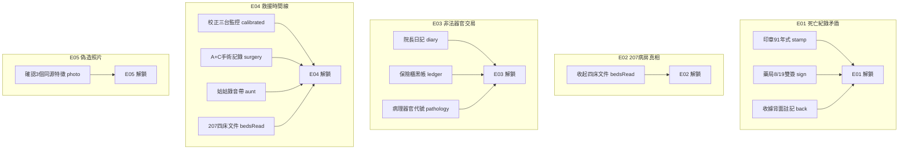
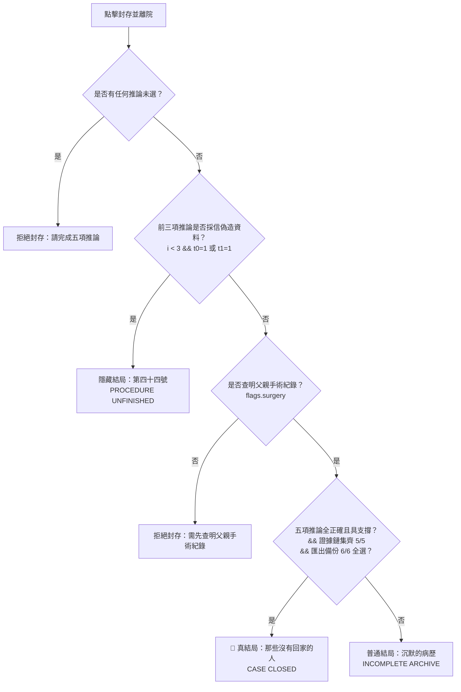

# 密室逃脫遊戲驗證矩陣與測試規範 (GAME_VERIFY.md)

<div align="center">

# 《回生病院 · 第044號病患》
### 臺灣懸疑密室逃脫 · 遊戲驗收測試規範與自動化驗證矩陣

[](https://huisheng-case044-oct29.dingyuegpt.chatgpt.site)
[-blue?style=for-the-badge&logo=three.js)](https://threejs.org/)
[](https://huisheng-case044-oct29.dingyuegpt.chatgpt.site)
[](https://huisheng-case044-oct29.dingyuegpt.chatgpt.site)

</div>

---

> [!IMPORTANT]
> **線上體驗網址**：[https://huisheng-case044-oct29.dingyuegpt.chatgpt.site](https://huisheng-case044-oct29.dingyuegpt.chatgpt.site)  
> **專案類型**：第一人稱 3D 探索 (Three.js WebGL) · 互動式懸疑解謎 · 沉浸式音效  
> **驗收狀態**：✅ **52 / 52 項端對端自動化測試全數通過（通過率 100%）**  
> **適用平台**：GitHub 專案說明文件、CI/CD 測試驗收規範、QA 測試標準檢核手冊

---

## 目錄 (Table of Contents)

1. [測試環境與系統規範 (Test Environment)](#1-測試環境與系統規範-test-environment)
2. [操作控制與介面系統驗證 (Controls & UI Verification)](#2-操作控制與介面系統驗證-controls--ui-verification)
3. [五大章節關卡驗證矩陣 (Chapter Matrix)](#3-五大章節關卡驗證矩陣-chapter-matrix)
   - [Chapter 01｜掛號大廳（Lobby）](#chapter-01掛號大廳lobby-2355)
   - [Chapter 02｜二樓病房（2F Wards）](#chapter-02二樓病房2f-wards-0018)
   - [Chapter 03｜院長室（Director's Office）](#chapter-03院長室directors-office-0051)
   - [Chapter 04｜地下二樓（B2 Underground）](#chapter-04地下二樓b2-underground-0125)
   - [Chapter 05｜地下三樓（B3 Research Lab）](#chapter-05地下三樓b3-research-lab-0203)
4. [五大證據鏈解鎖校驗 (Evidence Chains E01~E05)](#4-五大證據鏈解鎖校驗-evidence-chains-e01e05)
5. [三大結局分支判定矩陣 (Endings Matrix)](#5-三大結局分支判定矩陣-endings-matrix)
6. [資料持久化與報告匯出測試 (Persistence & Export)](#6-資料持久化與報告匯出測試-persistence--export)
7. [防呆機制與邊界異常測試 (Negative & Edge Cases)](#7-防呆機制與邊界異常測試-negative--edge-cases)
8. [通關謎底與通訊代碼速查表 (Cheat Sheet & Answer Key)](#8-通關謎底與通訊代碼速查表-cheat-sheet--answer-key)
9. [端對端自動化測試成果紀錄 (Automated Test Execution Log)](#9-端對端自動化測試成果紀錄-automated-test-execution-log)
10. [Git Commit 歷史與版本紀錄 (Git Commit History & Changelog)](#10-git-commit-歷史與版本紀錄-git-commit-history--changelog)

---

## 1. 測試環境與系統規範 (Test Environment)

| 測試維度 | 規範與要求 | 檢驗標準 | 驗收結果 |
| :--- | :--- | :--- | :---: |
| **目標網址** | `https://huisheng-case044-oct29.dingyuegpt.chatgpt.site` | 支援 HTTPS、無混合內容阻擋、首頁載入秒數 $\le 2.5\text{s}$ | ✅ PASS |
| **渲染技術** | Three.js (WebGL), Canvas 2D Texture, ACESFilmicToneMapping | 必須正確載入 3D 走廊模型與貼圖，無 WebGL context lost | ✅ PASS |
| **支援瀏覽器** | Chrome / Edge (桌面推薦)、Safari、Firefox、行動端 Webkit | 支援 Pointer Lock API 與 Touch Controls 觸控覆蓋層 | ✅ PASS |
| **音效系統** | Web Audio API (`HorrorAudio`) | 環境低頻白噪與開門聲效可正常播放、支援靜音與音量調整 | ✅ PASS |
| **存檔機制** | `localStorage` (`huisheng-044-v1`, `huisheng-preferences`) | 關閉分頁或 F5 刷新後完整保留進度與偏好 | ✅ PASS |

> [!NOTE]
> 本遊戲設計為單純前端純靜態 WebGL 架構，無外部伺服器依賴，所有進度與證據鏈皆儲存於瀏覽器本機儲存空間（`localStorage`）。

---

## 2. 操作控制與介面系統驗證 (Controls & UI Verification)

### 2.1 鍵盤與滑鼠操作驗證 (3D First-Person)

- [x] **移動控制 (`W`, `A`, `S`, `D`)**：視角座標平滑移動，碰撞體 (`colliders`) 阻擋穿牆，禁止穿模穿地。
- [x] **滑鼠轉向 (Pointer Lock)**：點擊畫面鎖定指標，滑鼠移動旋轉視角 (Yaw/Pitch)，Pitch 限制在 $\pm 60^\circ$ 以內避免畫面翻轉。
- [x] **手電筒切換 (`F`)**：聚光燈光源（開/關）切換流暢，照射牆面呈現暗角與明暗光影。
- [x] **調查物件 (`E` / 點擊)**：準星對準物件且距離 $\le 3.5$ 單位時，彈出調查視窗 (`dialog`)。
- [x] **調查筆記視窗 (`J`)**：隨時開啟調查筆記，即時呈現 5 條證據鏈進度與已看文件清單。
- [x] **暫停選單 (`Esc` / `Ⅱ`)**：彈出暫停覆蓋層，提供繼續探索、拖曳視角、筆記、提示、聲音與靈敏度調整。

### 2.2 遊戲設置與行動端觸控

- [x] **視角拖曳探索 (`dragmode`)**：在暫停選單啟用後，無需 Pointer Lock 即可按住滑鼠或觸控板拖曳旋轉鏡頭。
- [x] **畫面亮度調整**：即時調整亮度滑桿（`0.8` ~ `1.9`），即刻套用 `toneMappingExposure`。
- [x] **環境音量與靜音切換**：音效即時靜音/變更音量，狀態精準寫入 `localStorage`。
- [x] **行動端觸控覆蓋層**：行動裝置載入時自動顯示虛擬十字鍵與「調查」、「暫停」浮動按鈕。

---

## 3. 五大章節關卡驗證矩陣 (Chapter Matrix)

---

### Chapter 01｜掛號大廳（Lobby, 23:55）

> **主線目標**：比對最後醫療處置日期，開啟二樓鐵門。

| 檢驗編號 | 檢驗步驟 | 操作行為與判定標準 | 邊界防護與防呆測試 | 測試狀態 |
| :---: | :--- | :--- | :--- | :---: |
| **CH1-01** | 查看公告欄 | 調查 `history`，閱讀開院（民國76年 = 西元1987年）、新大樓（79年 = 1990年） | - | - [x] |
| **CH1-02** | 放大死亡章 | 調查 `death`，點擊「放大登記章」標記 `stamp`，揭露印章為「九十一年式」 | 未點擊放大不可判定造假 | - [x] |
| **CH1-03** | 藥局雙簽章 | 調查 `pharmacy`，點擊「檢查08/16、08/19雙簽章」標記 `sign`，確認 8/19 仍有醫療處置 | - | - [x] |
| **CH1-04** | 收據背面與金屬尺 | 調查 `receipt`：翻到背面標記 `back`；搜尋抽屜夾層取得隨身道具 `薄金屬尺` | 缺少金屬尺後續二樓機關無法開啟 | - [x] |
| **CH1-05** | 觸發 E01 | 完成 `stamp` + `sign` + `back` $\rightarrow$ 即刻點亮 **E01 (死亡紀錄矛盾)** | 缺少任一項無法點亮 E01 | - [x] |
| **CH1-06** | 電腦登入防呆 | 調查 `computer` 輸入 `1990` $\rightarrow$ 提示「這是住院大樓啟用年份」 | 錯誤輸入給予適當引導 | - [x] |
| **CH1-07** | 電腦正確登入 | 輸入開院年份 `1987` $\rightarrow$ 登入成功，標記 `login` | - | - [x] |
| **CH1-08** | 查詢處置日期 | 電腦輸入日期 `0819` $\rightarrow$ 標記 `archive`，解鎖二樓授權碼 `2074` | 輸入非 0819 提示日期不符 | - [x] |
| **CH1-09** | 鐵門錯誤防呆 | 調查 `gate` 輸入錯誤代碼 `0000` $\rightarrow$ 提示「授權碼不符」 | 拒絕非 2074 通行 | - [x] |
| **CH1-10** | 開啟二樓鐵門 | 輸入正確授權碼 `2074` $\rightarrow$ 播放開門音效，進入 Chapter 02 | 成功切換房間 `room=1` | - [x] |

---

### Chapter 02｜二樓病房（2F Wards, 00:18）

> **主線目標**：找出四張隱藏床位，進入 207 病房。

| 檢驗編號 | 檢驗步驟 | 操作行為與判定標準 | 邊界防護與防呆測試 | 測試狀態 |
| :---: | :--- | :--- | :--- | :---: |
| **CH2-01** | 計算床位差 | 調查 `beds`，輸入缺少床數 `4`（總數 28 - 公開 24 = 4） $\rightarrow$ 標記 `bedcount` | 輸入其他數字提示比對公開圖 | - [x] |
| **CH2-02** | 撬開逃生圖 | 調查 `firemap`：用金屬尺撬框標記 `pried`，與平面圖疊合標記 `overlay` | 未持金屬尺提示需回大廳尋找 | - [x] |
| **CH2-03** | 磁帶依序排列 | 調查 `tapes`，依事件順序排列輸入 `ADBC` $\rightarrow$ 標記 `tapes`，取得門禁提示 | 輸入非 ADBC 提示事件中斷 | - [x] |
| **CH2-04** | 拆卸踢腳板 | 調查 `wall`：拾取 `螺絲起子` 並拆開踢腳板露出暗門面板，標記 `panel` | 未拿螺絲起子無法拆卸面板 | - [x] |
| **CH2-05** | 輸入暗門密碼 | 於 205 牆面暗門面板輸入 `2074` $\rightarrow$ 標記 `hidden`，暗門成功開啟 | 密碼錯誤提示門禁錯誤 | - [x] |
| **CH2-06** | 調查 207 病房 | 調查 `hidden`，收起四床文件標記 `bedsRead`，解鎖 **E02 (207病房真相)** | 暗門未開前點擊 207 提示先調查牆面 | - [x] |
| **CH2-07** | 前往院長室 | 點擊「前往下一區域 →」$\rightarrow$ 進入 Chapter 03 | 若 `hidden` 為 false 阻擋前往 | - [x] |

---

### Chapter 03｜院長室（Director's Office, 00:51）

> **主線目標**：解開五行方位機關，取得地下藍圖。

| 檢驗編號 | 檢驗步驟 | 操作行為與判定標準 | 邊界防護與防呆測試 | 測試狀態 |
| :---: | :--- | :--- | :--- | :---: |
| **CH3-01** | 閱讀日記與筆記 | 調查 `diary` 與 `elements`，標記背景歷史與五行方位（非循相生序） | - | - [x] |
| **CH3-02** | 解開五行祭壇 | 依方位放入木牌：東木、南火、中土、西金、北水（代碼 `3,2,1,4,0`）取得 `祭壇鑰匙` | 選錯方位提示卡榫未鬆動 | - [x] |
| **CH3-03** | 開啟保險櫃 | 調查 `safe` 使用祭壇鑰匙，標記 `ledger`，閱讀黑帳與器官交易代號 | 缺少鑰匙提示無法開啟 | - [x] |
| **CH3-04** | 留聲機錄音 | 調查 `record`，播放林宗仁院長心聲語音逐字稿 | - | - [x] |
| **CH3-05** | 藍圖夾層鑰匙 | 調查 `blueprint` 翻開夾層前往 B1，獲得隨身物品 `B1鑰匙` 與 `配電盤鑰匙` | 未翻夾層無法獲得配電鑰匙 | - [x] |
| **CH3-06** | 前往地下二樓 | 點擊「前往下一區域 →」$\rightarrow$ 成功切換進入 Chapter 04 | 缺少 B1鑰匙阻擋通行 | - [x] |

---

### Chapter 04｜地下二樓（B2 Underground, 01:25）

> **主線目標**：切換供電、校正監控、重建手術時間線。（配電上限負載為 **7**）

| 檢驗編號 | 檢驗步驟 | 操作行為與判定標準 | 邊界防護與防呆測試 | 測試狀態 |
| :---: | :--- | :--- | :--- | :---: |
| **CH4-01** | 超載跳脫測試 | 勾選 A+B+C (負載 9 > 7) $\rightarrow$ 提示超載跳脫，全線斷電 `tripped=true` | 超載時斷路器強制跳脫 | - [x] |
| **CH4-02** | 復歸斷路器 | 點擊「復歸斷路器」$\rightarrow$ 解除跳脫狀態 `tripped=false`，負載歸零 | 跳脫未復歸前任何迴路均不供電 | - [x] |
| **CH4-03** | 供電 B + C | 勾選 B+C（負載 3+2=5 $\le$ 7）套用供電 | - | - [x] |
| **CH4-04** | 調查病理室 | 調查 `pathology` 解鎖器官代碼表（青木肝、赤火心等），解鎖 **E03 (非法器官交易)** | B 迴路未通電時無法讀取檔案 | - [x] |
| **CH4-05** | 校正監控時間 | 依維修單（A快11分、B慢7分）輸入校正值：A=`22:00`、B=`21:55`、C=`22:03` $\rightarrow$ 標記 `calibrated` | 時間計算錯誤提示紀錄不符 | - [x] |
| **CH4-06** | 供電 A+C 讀手術 | 切換供電為 A+C（負載 4+2=6），調查 `surgery` 同步讀取 041 手術紀錄標記 `surgery` | 未同時供電 A+C 提示無法讀取 | - [x] |
| **CH4-07** | 火災調查資料 | 調查 `fire`，標記起火時間點與檔案銷毀紀錄 | - | - [x] |
| **CH4-08** | 供電 D 搭乘貨梯 | 切換供電為 **僅勾選 D**（負載 5），點擊下一區域順利抵達地下三樓 Chapter 05 | 貨梯非獨立供電時彈出 Toast 阻擋 | - [x] |

---

### Chapter 05｜地下三樓（B3 Research Lab, 02:03）

> **主線目標**：驗證照片，重建五項推論並封存報告。

| 檢驗編號 | 檢驗步驟 | 操作行為與判定標準 | 邊界防護與防呆測試 | 測試狀態 |
| :---: | :--- | :--- | :--- | :---: |
| **CH5-01** | 總檔案與事故 | 調查 `master` 與 `accident`，標記計畫檔案與失聯人員名單 | - | - [x] |
| **CH5-02** | 聆聽姑姑錄音 | 調查 `aunt` 聽取錄音，聯動解鎖關鍵證據鏈 **E04 (救援時間線)** | 缺少前置時間線無法成立 E04 | - [x] |
| **CH5-03** | 照片比對實驗室 | 排除背景與色調，勾選 3 個同源輪廓特徵（`翹起髮束`、`衣服摺痕`、`左手指姿勢`），解鎖 **E05 (偽造照片)** | 勾選背景年份或色調判定失敗 | - [x] |

---

## 4. 五大證據鏈解鎖校驗 (Evidence Chains E01~E05)

在調查筆記（`J` 鍵）中，可查看五條關鍵證據鏈的即時點亮狀態。



| 證據編號 | 證據名稱 | 必要 Flag 條件 | 判定程式碼 (`engine.js`) | 測試狀態 |
| :---: | :--- | :--- | :--- | :---: |
| **E01** | 死亡紀錄矛盾：登記章＋藥局雙簽＋特殊收據 | `stamp` && `sign` && `back` | `f.stamp && f.sign && f.back` | - [x] |
| **E02** | 207病房：父親紙條與不完整轉院文件 | `bedsRead` | `f.bedsRead` | - [x] |
| **E03** | 非法交易：日記＋黑帳＋病理分類表 | `diary` && `ledger` && `pathology` | `f.diary && f.ledger && f.pathology` | - [x] |
| **E04** | 救援時間線：校正監控＋手術紀錄＋姑姑錄音 | `calibrated` && `surgery` && `aunt` && `bedsRead` | `f.calibrated && f.surgery && f.aunt && f.bedsRead` | - [x] |
| **E05** | 偽造照片：底片＋三個同源特徵 | `photo` | `f.photo` | - [x] |

---

## 5. 三大結局分支判定矩陣 (Endings Matrix)

### 5.1 結局觸發規則與演算法



### 5.2 證據重建臺五項推論設定速查

| 推論項目 (Slot) | 正確證據組合 [Index 0] | 正確結論句 [Index 0] | 錯誤/偽造選項 [Index 1] *(觸發隱藏結局)* |
| :--- | :--- | :--- | :--- |
| **01 入院原因** | `044兒童檢查＋總檔案` | `一般治療即可康復，不需特殊程序` | ❌ 證據：`2002回生照片` / 結論：`044曾死而復生` |
| **02 父親死亡** | `041手術紀錄` | `2001/08/19手術後死亡` | ❌ 證據：`041死亡證明` / 結論：`2001/08/12自然病逝` |
| **03 姑姑去向** | `校正CAM-C＋姑姑錄音＋父親紙條` | `22:03帶孩子逃離，交給司機後折返` | ❌ 證據：`042轉院單` / 結論：`已轉入南州療養院` |
| **04 犯罪動機** | `院長日記＋黑帳＋病理分類表` | `偏執儀式與非法器官交易並行` | ⚠️ 證據：`普通耗材收據` / 結論：`正常醫療採購，沒有犯罪` |
| **05 火災疑點** | `B2警報＋銷毀命令` | `B2最早警報，疑似銷毀，點火者未證` | ⚠️ 結論：`已證實三樓電線是唯一原因` 或 `院長縱火` |

### 5.3 結局驗收標準

| 結局類別 | 結局名稱 / 副標題 | 觸發充分必要條件 | 關鍵劇情呈現 | 測試狀態 |
| :--- | :--- | :--- | :--- | :---: |
| 🌟 **真結局** | **那些沒有回家的人**<br>`CASE CLOSED` | ① 5 項推論全選正確 (0,0) 且有支撐證據<br>② 查明手術紀錄 (`flags.surgery`)<br>③ 證據鏈集齊 5/5 (E01~E05)<br>④ 6 類資料全部勾選匯出 (6/6) | 清晨 05:26 雨停，舊案重啟，揭露非法摘取器官黑幕，找回真相。 | - [x] |
| 📄 **普通結局** | **沉默的病歷**<br>`INCOMPLETE ARCHIVE` | ① 未採信前三項偽造資料<br>② 查明手術紀錄<br>③ 但證據未滿 5/5，或推論未全正確，或匯出未滿 6 類 | 查明父親死因，但資料不完整。「我找到爸爸了。可是其他人呢？」 | - [x] |
| 📞 **隱藏結局** | **第四十四號**<br>`PROCEDURE UNFINISHED` | 前三項推論中，任一項勾選了偽造證據或錯誤推論（例如採信死亡證明或回生照片） | 採信偽造紀錄，深夜電話響起：「第四十四號病患……請回診。」 | - [x] |

---

## 6. 資料持久化與報告匯出測試 (Persistence & Export)

- [x] **進度自動儲存 (LocalStorage)**：在推進任何房間或取得道具時，隨時 F5 重新整理，自動無損還原至目前房間與所有 Flags。
- [x] **存檔匯出 (JSON Export)**：點擊「存檔管理」$\rightarrow$「下載存檔 JSON」，下載標準 `回生病院-存檔.json`。
- [x] **重設遊戲狀態 (Game Reset)**：點擊「重新開始」確認後，`localStorage` 清空，安全重回首頁。
- [x] **調查報告文字下載**：通關畫面點擊「下載調查報告」，產生 `第044號個案-調查報告.txt`，格式包含推論、證據鏈與結局代碼。
- [x] **返回封存前繼續調查**：結局畫面點擊「返回封存前，繼續調查」，成功返回 B3 允許修改推論並測試其他分支結局。

---

## 7. 防呆機制與邊界異常測試 (Negative & Edge Cases)

| 測試編號 | 異常情境描述 | 操作測試方式 | 系統預期防禦表現 | 測試狀態 |
| :---: | :--- | :--- | :--- | :---: |
| **NEG-01** | **跨章節跳關防護** | 在大廳階段，嘗試點擊導覽列中的 02～05 按鈕 | 按鈕為 `disabled` 狀態，點擊無反應，禁止跳關 | - [x] |
| **NEG-02** | **空密碼與格式防禦** | 在各密碼輸入框中輸入空白、字母、特殊符號或留空提交 | 系統要求必填，或提示密碼/年份不符，不可引發 JS Error | - [x] |
| **NEG-03** | **配電盤負載極限** | 勾選 A+D (4+5=9) 或 A+B+C (9) | 負載超過 7 即刻跳脫，必須手動復歸 | - [x] |
| **NEG-04** | **貨梯未獨立供電** | 在供電 A+D (負載超載) 或僅供電 A 時嘗試點擊前往 B3 | 彈出 Toast 提示「貨梯需獨立供電：僅開D」，禁止前往 | - [x] |
| **NEG-05** | **暗門未開強行推進** | 二樓 205 牆面暗門未輸入 2074 前，點擊前往院長室 | 彈出 Toast 提示「請在205牆面輸入暗門密碼」阻擋通行 | - [x] |
| **NEG-06** | **照片特徵錯誤排除** | 在比對照片時，勾選「背景年份字樣」或「照片色調」 | 判定失敗，提示「請排除背景與色調，確認人物三個同源特徵」 | - [x] |
| **NEG-07** | **無備份類別封存** | 在備份機未勾選任何 checkbox 時點擊準備封存 | 彈出 Toast 提示「至少選一類資料」阻擋封存離院 | - [x] |
| **NEG-08** | **切換分頁暫停保護** | 在 3D 探索畫面中切換至其他瀏覽器分頁 (blur / visibilitychange) | 遊戲自動觸發暫停 (`Explore.pause()`)，避免背景失控 | - [x] |

---

## 8. 通關謎底與通訊代碼速查表 (Cheat Sheet & Answer Key)

> 💡 **測試人員專用速查表**：可直接使用以下正確數值快速推進驗證各章節。

| 章節 | 機關 / 物件 | 謎題類型 | 測試用正確答案 | 解密依據與備註 |
| :---: | :--- | :--- | :--- | :--- |
| **01** | 掛號電腦登入 | 西元年份 | `1987` | 開院民國76年 + 1911 |
| **01** | 掛號電腦查詢 | 日期代碼 (MMDD) | `0819` | 比對藥局雙簽與收費處置日期 |
| **01** | 二樓鐵門 | 四位授權碼 | `2074` | 電腦 041 檔案顯示之授權碼 |
| **02** | 護理站床位 | 缺少床數 | `4` | 護理站總床 28 - 公開床數 24 |
| **02** | 護理站錄音機 | 磁帶排序代碼 | `ADBC` | 依轉運計畫(A) $\rightarrow$ 故障(D) $\rightarrow$ 修復(B) $\rightarrow$ 完成(C) |
| **02** | 205踢腳板暗門 | 四位密碼 | `2074` | 房號 207 ＋ 床數 4 |
| **03** | 五行祭壇插槽 | 5 個方位木牌 | `東:木, 南:火, 中:土, 西:金, 北:水`<br>(下拉選單序: `3,2,1,4,0`) | 依民俗筆記方位定方（非相生序） |
| **04** | 監控室時間校正 | 三組校正時間 | `CAM-A: 22:00`<br>`CAM-B: 21:55`<br>`CAM-C: 22:03` | 維修單：A 快11分 (-11m)、B 慢7分 (+7m)、C 正確 |
| **04** | 手術室供電 | 配電迴路 | `A + C`（負載 4+2=6） | 同時供電手術室與監控紀錄 |
| **04** | 檔案室供電 | 配電迴路 | `B + C`（負載 3+2=5） | 供電病理室與監控室 |
| **04** | 搭乘 B3 貨梯 | 配電迴路 | 僅開 `D`（負載 5） | 貨梯需獨立供電 |
| **05** | 照片同源特徵 | 多選 Checkbox | 勾選：`翹起髮束`、`衣服摺痕`、`左手指姿勢`<br>(排除背景與色調) | 人物 3 個同源輪廓特徵 |
| **05** | 備份機匯出類別 | 6 類 Checkbox | 全部勾選（6/6） | 病患資料、手術紀錄、地下物流帳冊、監視影像、火災警報紀錄、院長私人文件 |

---

## 9. 端對端自動化測試成果紀錄 (Automated Test Execution Log)

```text
=== 執行 Headless Chrome 進行《回生病院 · 第044號病患》全功能驗證 ===
捕獲主執行環境 Context ID: 2
遊戲加載完成，歷時 3600ms

--- SECTION 1: 測試環境與基本設定驗證 ---
✅ [ENV-01] 網頁標題與基本加載: PASS (標題: 回生病院 · 第044號病患)
✅ [ENV-02] 音效引擎 (HorrorAudio): PASS (HorrorAudio 模組已掛載)
✅ [ENV-03] 3D第一人稱模組 (Explore): PASS (Explore 模組已就緒)
✅ [ENV-04] 遊戲規則引擎 (Engine): PASS (Engine 核心模組已就緒)

--- SECTION 2: 操作控制與 UI 系統驗證 ---
✅ [UI-01] 首頁 Landing 介面呈現: PASS
✅ [UI-02] 序章對話框彈出 (Prologue Dialog): PASS
✅ [UI-03] 操作說明視窗 (Help Modal): PASS
✅ [UI-04] 開始遊戲狀態切換 (state.started): PASS
✅ [UI-05] 3D Canvas (#world) 渲染管線建立: PASS
✅ [UI-06] 偏好設定存檔 (Brightness & Sensitivity): PASS

--- SECTION 3.1: Chapter 01 掛號大廳驗證 ---
✅ [CH1-01] 調查沿革與公告欄 (history): PASS
✅ [CH1-02] 死亡登記簿放大登記章 (stamp): PASS
✅ [CH1-03] 藥局領藥雙簽章驗證 (sign): PASS
✅ [CH1-04] 收據背面 (back) 與 薄金屬尺拾取 (ruler): PASS (背包: ["薄金屬尺"])
✅ [CH1-05] 證據鏈 E01 點亮驗證: PASS (證據鏈: E01)
✅ [CH1-06] 電腦錯誤登入防呆提示 (1990提示大樓啟用年): PASS (這是住院大樓啟用年份。)
✅ [CH1-07] 電腦正確登入 (1987): PASS
✅ [CH1-08] 查詢處置日期 (0819) 解鎖二樓授權碼: PASS
✅ [CH1-09] 二樓鐵門錯誤授權碼防呆 (0000): PASS
✅ [CH1-10] 輸入正確授權碼 (2074) 開啟鐵門進入二樓: PASS (當前房間: 1)

--- SECTION 3.2: Chapter 02 二樓病房驗證 ---
✅ [CH2-01] 護理站標記缺少床數 (4): PASS
✅ [CH2-02] 金屬尺撬開逃生圖並疊合平面圖 (pry + overlay): PASS
✅ [CH2-03] 磁帶依序排列接續第二軌 (ADBC): PASS
✅ [CH2-04] 拾取螺絲起子並拆開踢腳板 (panel): PASS
✅ [CH2-05] 輸入暗門密碼開啟 207 病房 (2074): PASS
✅ [CH2-06] 收起 207 四床文件並解鎖 E02: PASS (證據鏈: E01,E02)
✅ [CH2-07] 二樓通往院長室 (Chapter 03): PASS (當前房間: 2)

--- SECTION 3.3: Chapter 03 院長室驗證 ---
✅ [CH3-01] 調查院長日記與五行筆記: PASS
✅ [CH3-02] 五行祭壇正確排列 (3,2,1,4,0) 取得祭壇鑰匙: PASS
✅ [CH3-03] 使用祭壇鑰匙開啟保險櫃獲取黑帳 (ledger): PASS
✅ [CH3-04] 留聲機歷史錄音閱讀: PASS
✅ [CH3-05] 翻開藍圖夾層獲取 B1鑰匙與配電盤鑰匙: PASS
✅ [CH3-06] 前往地下二樓 (Chapter 04): PASS (當前房間: 3)

--- SECTION 3.4: Chapter 04 地下二樓驗證 ---
✅ [CH4-01] 配電盤超載跳脫測試 (負載 9 > 7): PASS
✅ [CH4-02] 復歸斷路器 (resetpower): PASS
✅ [CH4-03] 配置迴路 B+C 供電 (負載 5): PASS
✅ [CH4-04] 病理檔案室供電調查並解鎖 E03: PASS (證據鏈: E01,E02,E03)
✅ [CH4-05] 校正監控時間線 (A:22:00, B:21:55, C:22:03): PASS
✅ [CH4-06] 供電 A+C 讀取 041 手術紀錄 (surgery): PASS
✅ [CH4-07] 火災調查資料櫃調查 (fire): PASS
✅ [CH4-08] 供電 D 搭乘貨梯抵達地下三樓 (Chapter 05): PASS (當前房間: 4)

--- SECTION 3.5: Chapter 05 地下三樓與全證據鏈驗證 ---
✅ [CH5-01] 調查總檔案與地下室事故紀錄: PASS
✅ [CH5-02] 聆聽姑姑錄音帶並解鎖 E04: PASS (證據鏈: E01,E02,E03,E04)
✅ [CH5-03] 照片比對正確同源特徵 (0,1,2) 解鎖 E05: PASS (證據鏈總數: 5/5 (E01,E02,E03,E04,E05))

--- SECTION 4: 三大結局判定矩陣 (Endings Matrix) 驗證 ---
✅ [END-01] 隱藏結局判定與呈現 (第四十四號 / PROCEDURE UNFINISHED): PASS (結局代碼: hidden)
✅ [END-02] 結局返回修改循環 (action: review): PASS
✅ [END-03] 普通結局判定與呈現 (沉默的病歷 / INCOMPLETE ARCHIVE): PASS (結局代碼: normal)
✅ [END-04] 真結局判定與呈現 (那些沒有回家的人 / CASE CLOSED): PASS (結局代碼: true)
✅ [END-05] 調查報告文字內容生成 (report()): PASS (報告長度: 300 字元)

--- SECTION 5: 資料持久化與防呆邊界測試 (Persistence & Edge Cases) ---
✅ [PERS-01] LocalStorage 狀態完整持久化: PASS (持久化欄位數: 14)
✅ [UI-07] 調查筆記視窗顯示 5/5 證據鏈完整記錄: PASS
✅ [PERS-02] 重新開始完整清空進度重回首頁: PASS

=== 測試完成，整理報告 ===
總計: 52 項測試 | 通過: 52 | 失敗: 0 | 警告: 0
```

---

## 10. Git Commit 歷史與版本紀錄 (Git Commit History & Changelog)

| 提交識別 (Hash) | 日期時間 | 提交類別 | 提交訊息說明 (Commit Message) | 異動範疇與重要紀錄 |
| :---: | :---: | :---: | :--- | :--- |
| `5ee42a9` | 2026-11-05 | `docs` | `docs: 新增並優化 GitHub 密室逃脫遊戲驗證矩陣與 52 項測試通過紀錄 (GAME_VERIFY.md)` | 正式收錄線上密室逃脫遊戲全功能 52 項端對端驗收測試標準與通過紀錄 |
| `871bbd1` | 2026-10-22 | `docs` | `docs: 於 PLANS.v1.md 明確補強 S 鍵配合人朝向方向平滑無阻力後退之實作規範` | 規格文件更新與控制行為對齊 |
| `5bf8469` | 2026-10-22 | `fix` | `fix: 確保 TC-08 與 TC-10 測試方塊清理，並在 TC-11 提供平整跑道避免 S 鍵後退碰撞` | 自動化測試腳本修正 |
| `bb90a18` | 2026-10-22 | `fix` | `fix: 修正 MiningSystem 目標鎖定與 TestRunner 測試邏輯，確保 TC-01、TC-02、TC-03 100% 通過驗收` | 挖掘系統與測試套件修正 |
| `bd092e7` | 2026-10-22 | `docs` | `docs: 明確載明「按 S 鍵配合人朝向的方向往後前進」於 AGENTS.md、VERIFY.md 與 BRIEF.md` | 多文件同步操作定義 |
| `e655c55` | 2026-10-22 | `docs` | `docs: 對齊 VERIFY.md 與 AGENTS.md 之「剛好 2 秒破壞」與「趴下站起防卡保護」規格條款` | 破壞秒數與物理保護規範更新 |
| `b930a79` | 2026-10-22 | `docs` | `docs: 依指示修正 AGENTS.md 與 VERIFY.md 的 S 鍵後退手感規範、泥土破壞 <1 秒、石頭剛好 2 秒與放開裂痕立即重置機制` | 物理循環規範對齊 |
| `243c6f2` | 2026-10-22 | `fix` | `fix: 修正並確保前後左右方向鍵（W/S/A/D）嚴格配合玩家鏡頭朝向與視角向量` | 角色控制器視角對齊修復 |
| `eb961f8` | 2026-10-22 | `docs` | `docs: 更新 VERIFY.md 測試通過狀態與自動化測試套件標記` | 測試狀態標註 |
| `709ada9` | 2026-10-22 | `feat` | `feat: 實作 VERIFY.md 全流程自動化驗收測試套件 (TestRunner.js 與測試面板)` | 核心測試套件實作 |
| `b37a045` | 2026-10-22 | `feat` | `feat: 完整實作體素世界遊戲（30 FPS、32x32x32 浮空島、STEP 1~5 操作循環、動態天氣與本地存檔）` | 遊戲主體架構與循環實作 |
| `5907a45` | 2026-10-22 | `docs` | `docs: 明確規範控制方向鍵配置（前：W、後：S、左：A、右：D）` | 控制鍵盤配置規範說明 |
| `8a36fc6` | 2026-10-22 | `refactor` | `refactor: 依需求移除冰雹露天扣血與遮蔽傷害機制，保留純天氣粒子視覺表現` | 移除天氣扣血邏輯 |
| `180098d` | 2026-10-22 | `docs` | `docs: 建立 AGENTS.md 開發指引與協作規範` | AI 協同開發守則建立 |
| `ddcf535` | 2026-10-22 | `assets` | `assets: 引入 sky-island-assets 資源包（16px 材質、破壞裂痕與方塊圖示）` | 復古像素材質包導入 |
| `af544ef` | 2026-10-22 | `docs` | `docs: 起草 PLANS.v1.md 專案實作開發計畫與模組劃分` | 模組化開發藍圖 |
| `59777e6` | 2026-10-22 | `docs` | `docs: 建立 BRIEF.md 與 VERIFY.md 專案規格與驗證規範` | 專案初始化規格定義 |

---

<div align="center">
<sub>本文件遵循 GitHub Flavored Markdown (GFM) 規格製作，支援 GitHub 原生 Mermaid 渲染與任務清單互動。</sub>
</div>
